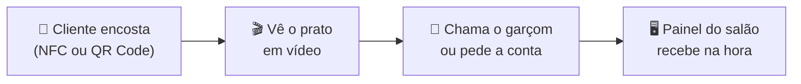
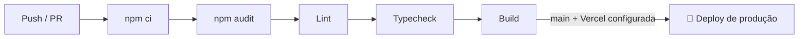

<div align="center">


### Seu cardápio *em movimento*, em cada mesa.

Landing page do **nexo.menu**, o cardápio digital do grupo Nexo para restaurantes de Petrolina-PE.

[](https://github.com/iguilhermegc/NEXO/actions/workflows/ci-cd.yml)


[Como funciona](#como-funciona) · [Stack](#stack) · [Rodando localmente](#rodando-localmente) · [CI/CD](#cicd) · [Estrutura](#estrutura) · [Design](#design)

</div>

---

## Como funciona

O cliente encosta o celular na tag da mesa, vê o prato em vídeo e chama o garçom ou pede a conta. O restaurante recebe tudo no painel do salão. A Nexo monta e atualiza o cardápio.



| | O que o restaurante recebe |
| :---: | --- |
| 📖 | Cardápio com a marca da casa (cores, logo e fotos) |
| 🎥 | Vídeos de 8 a 10 pratos, filmados e editados pela Nexo |
| 🏷️ | Tag em acrílico com NFC e QR Code em cada mesa |
| 🔔 | Garçom e conta chamados pelo celular do cliente |
| 🖥️ | Painel do salão com os chamados em tempo real |
| 🔄 | Atualizações do cardápio incluídas |

## Stack

| Camada | Tecnologia |
| --- | --- |
| Framework | [Next.js 16](https://nextjs.org) (App Router, Turbopack) |
| UI | React 19, CSS puro em `app/globals.css` |
| Linguagem | TypeScript 7 (com a API do TS 6 só para o ESLint) |
| Tipografia | Instrument Serif e Geist via `next/font` |
| Movimento | [Lenis](https://lenis.darkroom.engineering) (scroll suave) e [ScrollReveal](https://scrollrevealjs.org) (entradas) |
| E-mail | [Resend](https://resend.com), usado pelo formulário de contato |
| Qualidade | ESLint (`eslint-config-next`), GitHub Actions e Dependabot |

## Rodando localmente

> **Requisitos:** Node.js 26 (veja `.nvmrc`) e npm.

```bash
npm install
cp .env.example .env.local   # preencha as variáveis
npm run dev
```

Abra **http://localhost:3000**.

### Scripts

| Comando | O que faz |
| --- | --- |
| `npm run dev` | Servidor de desenvolvimento |
| `npm run build` | Build de produção |
| `npm run start` | Serve o build de produção |
| `npm run lint` | ESLint em todo o projeto |
| `npm run typecheck` | Gera os tipos das rotas e roda o `tsc` |

### Variáveis de ambiente

Ficam em `.env.local` (modelo em `.env.example`). Só o formulário de contato usa: sem elas a página funciona, mas o envio responde com erro.

| Variável | Obrigatória | Descrição |
| --- | :---: | --- |
| `RESEND_API_KEY` | ✅ | Chave da API do Resend |
| `CONTACT_TO_EMAIL` | ✅ | E-mail da Nexo que recebe os contatos |
| `CONTACT_FROM_EMAIL` | — | Remetente. Padrão `nexo.menu <onboarding@resend.dev>`, que só entrega para o dono da conta Resend enquanto não houver domínio verificado |

## CI/CD

O workflow [`.github/workflows/ci-cd.yml`](.github/workflows/ci-cd.yml) roda em todo push na `main`, em todo pull request e manualmente.



- **CI:** instala as dependências, audita as de produção (falha em vulnerabilidade alta ou crítica), roda lint, checagem de tipos e build.
- **CD:** depois do CI verde na `main`, publica em produção na Vercel. Esse job fica desligado até o projeto ser configurado.
- **Dependabot:** abre PRs semanais para dependências npm e mensais para as GitHub Actions.

<details>
<summary><b>Ativando o deploy na Vercel</b></summary>

1. Crie o projeto na Vercel e rode `npx vercel link` na pasta do projeto. O arquivo `.vercel/project.json` mostra o `orgId` e o `projectId`.
2. Em **Settings → Secrets and variables → Actions** do repositório no GitHub:
   - **Variables:** `VERCEL_ORG_ID` e `VERCEL_PROJECT_ID`
   - **Secrets:** `VERCEL_TOKEN` (crie em vercel.com/account/tokens)
3. Cadastre `RESEND_API_KEY`, `CONTACT_TO_EMAIL` e `CONTACT_FROM_EMAIL` nas variáveis de ambiente de produção do projeto na Vercel.
4. Se o projeto também estiver ligado ao GitHub pela integração da Vercel, desative os deploys automáticos dela para não publicar duas vezes.

</details>

## Estrutura

```
app/
├── layout.tsx              Fontes, metadados e scroll suave
├── page.tsx                Seções da landing
├── globals.css             Todo o sistema visual
└── api/contato/route.ts    POST do formulário: valida, filtra robôs e envia via Resend
components/
├── HeroScrub.tsx           Hero com animação guiada pelo scroll
├── Steps.tsx               "Como funciona" em 3 passos
├── Panel.tsx               Mockup do painel do salão
├── FaqSection.tsx          Acordeão de dúvidas
├── ContactForm.tsx         Formulário de contato
├── ScrollChrome.tsx        Header
├── SmoothScroll.tsx        Lenis
├── Reveal.tsx              ScrollReveal
└── Footer.tsx · Logo.tsx · icons.tsx
public/
└── nexo-logo.png
```

## Design

O sistema visual (cores, tipografia, componentes e layout) está em [DESIGN.md](DESIGN.md). A fonte da verdade é `app/globals.css`: se os dois divergirem, vale o CSS.

| Token | Cor | Uso |
| --- | --- | --- |
| `--creme` |  | Fundo base |
| `--marrom` |  | Acento único: botões, ícones, seções de marca |
| `--preto` |  | Texto, rodapé, moldura dos mockups |

---

<div align="center">
<sub>Um produto do grupo Nexo · Petrolina, PE</sub>
</div>
